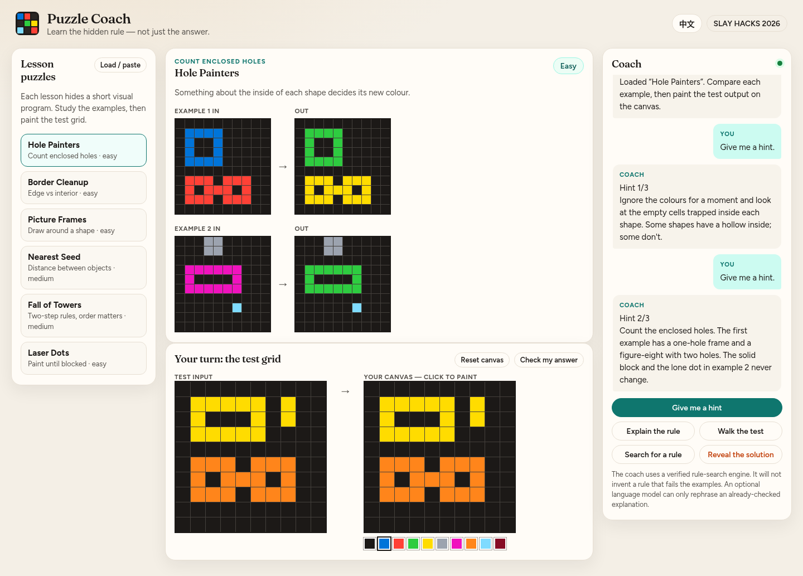
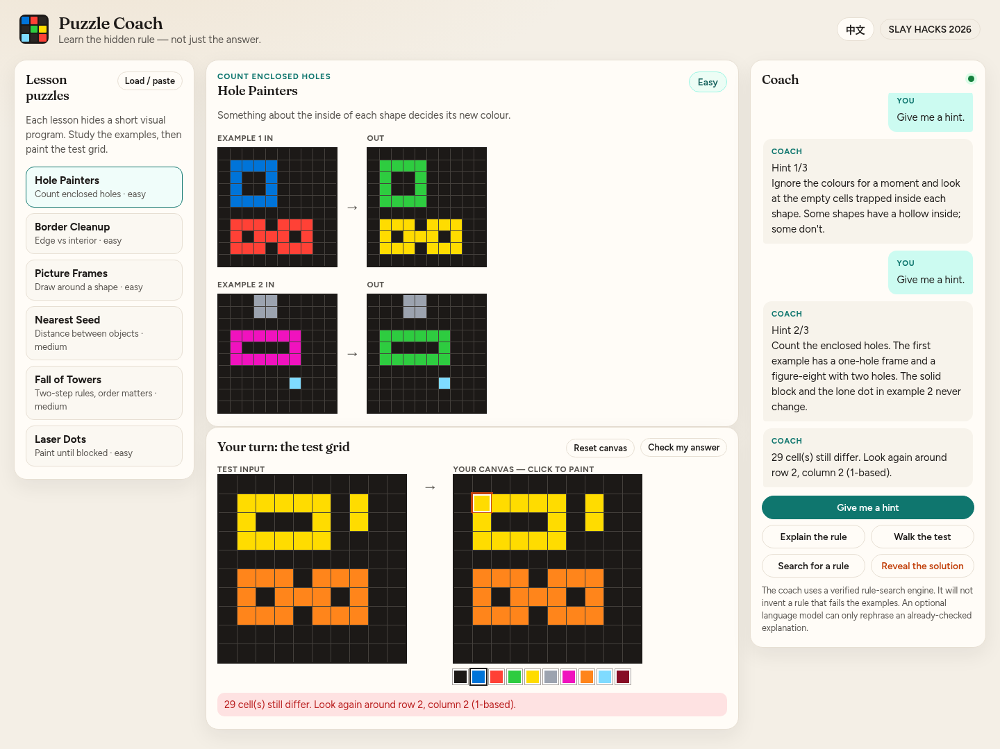
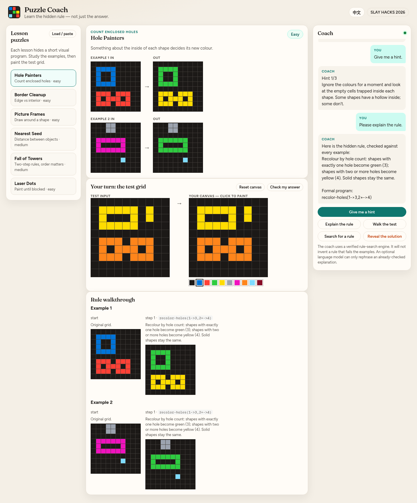
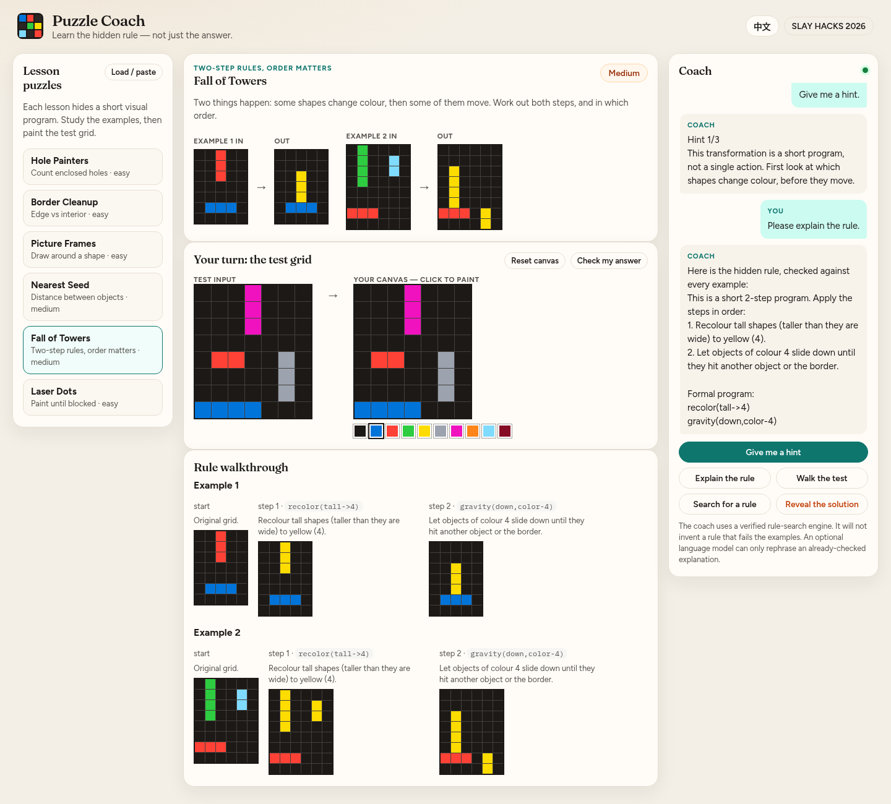

# Puzzle Coach

An AI tutoring assistant that teaches people how to solve ARC-style logic and grid puzzles.

Most AI tools just fill in the answer. Puzzle Coach does the opposite: it studies the examples with you, gives hints one step at a time, and explains the hidden rule in plain language — only after a symbolic engine has *verified* that the rule fits every example.

Built as a working prototype for [SLAY HACKS 2026](https://slayy-hacks.devpost.com/) (individual student project).



## The problem

Abstract reasoning puzzles (the kind used in the Abstraction and Reasoning Corpus, and in many logic games) are a good way to practise the skill of *finding a rule from examples*. Students often get stuck, and a chatbot that simply prints the output grid does not help them learn. What they need is a tutor that can:

1. Point out what is worth noticing.
2. Name the hidden rule in everyday language.
3. Show how that rule transforms a grid, step by step.
4. Let them try the test grid themselves, and check the attempt without spoiling every cell.

## How it uses AI

Puzzle Coach is not a thin wrapper around a chatbot.

**The primary AI is a symbolic rule-induction engine.** It searches a vocabulary of visual operators (recolour by a property, delete, draw a frame, fill a hole, gravity, rays, nearest-seed colouring, and so on) and keeps only those short programs that reproduce every training example *exactly*. The test grid is never used to pick the program. If two programs fit the examples, the coach can say so.

That matters for responsible tutoring: the explanation is faithful to a checked program. The engine cannot “hallucinate” a rule that fails the examples in front of you.

**An optional language model can only rephrase** an already-verified explanation. It is off by default, needs no paid credits, and the app is fully usable offline without any API key. If you want friendlier wording, set `PUZZLECOACH_LLM_KEY` (or `OPENAI_API_KEY`) and optionally `PUZZLECOACH_LLM_BASE` / `PUZZLECOACH_LLM_MODEL`. Never put keys in the repository.

## Features

- Six built-in lessons, from “count the holes” to a two-step “recolour, then fall” program.
- Progressive hints, written for each lesson, plus automatic observations on custom puzzles.
- A paintable test canvas, with a check that highlights a region still to fix — it does not fill in the answer for you.
- A rule walkthrough that shows the grid after each operator.
- Load your own puzzle as ARC-style JSON or as example/test text.
- English / 中文 interface.
- Works entirely on your machine; no account and no network required for the engine.

### Built-in lessons

| Lesson | What you practise |
| --- | --- |
| Hole Painters | An interior property (holes) decides each shape’s new colour. |
| Border Cleanup | Some objects vanish; notice where the vanishing ones sit. |
| Picture Frames | New cells appear around some objects — what do they have in common? |
| Nearest Seed | Big shapes change colour; single-cell “seeds” do the colouring. |
| Laser Dots | A few cells shoot colour across a row; what starts a ray, and what stops it? |
| Fall of Towers | Two-step program: some shapes recolour, then some of them move. |







## How to run

You need Python 3.10+ (3.13 is fine).

```bash
git clone https://github.com/zdfgu113/puzzle-coach.git
cd puzzle-coach
python3 -m venv .venv
source .venv/bin/activate        # Windows: .venv\Scripts\activate
pip install -r requirements.txt
python app.py
```

Then open [http://127.0.0.1:5000](http://127.0.0.1:5000).

## Tests

The checks verify every built-in lesson (authored rules match all examples and the hidden test), that English and Chinese explanations are produced, that the attempt checker flags a wrong region, that the JSON/text loaders parse a puzzle, and that the search engine recovers the intended programs — including the two-step Fall of Towers rule:

```bash
source .venv/bin/activate
python -m unittest tests.test_puzzles
```

### Optional LLM polish

```bash
export PUZZLECOACH_LLM_KEY=sk-...          # do not commit this
export PUZZLECOACH_LLM_MODEL=gpt-4o-mini  # or any OpenAI-compatible chat model
# export PUZZLECOACH_LLM_BASE=https://api.openai.com/v1
```

The web app still works if these are unset.

### Load a custom puzzle

Use **Load / paste** and drop in either:

```json
{
  "examples": [
    {"input": [[0,2,0],[0,2,0],[0,0,0]], "output": [[0,0,0],[0,0,0],[0,4,0]]}
  ],
  "test": [[0,3,0],[0,3,0],[0,0,0]]
}
```

or the text form:

```
Example 1 input
020
020
000

Example 1 output
000
000
040

Test input
030
030
000
```

The `puzzles/` folder has the six lessons in JSON if you want a starting template. Tick “border marker” only if the puzzle uses a unique coloured cell on the border as a reference.

## Demo video

A 2 minute 41 second walkthrough with English narration and subtitles is in [docs/demo.mp4](docs/demo.mp4). It was recorded from the real running app and shows layered hints, the attempt checker, a verified rule walkthrough, the two-step lesson, loading a custom puzzle, and the English / 中文 switch.

The spoken script is in [docs/demo-narration.md](docs/demo-narration.md); the original shot list is in [docs/demo-script.md](docs/demo-script.md). Still frames from the video are under [docs/demo-frames/](docs/demo-frames/).

## Project layout

```
app.py                 Flask app and tutoring API
puzzlecoach/
  engine.py            Grid operators and predicates
  search.py            Beam search over short rule programs
  coach.py             Hints and plain-language explanations
  puzzles.py           Built-in lessons
  format.py            JSON / text loaders
  llm.py               Optional explanation polish
static/  templates/    Web UI
puzzles/               Lesson JSON
docs/                  Screenshots, demo video, and Devpost draft text
tests/                 Unit checks
```

## What this prototype does not do yet

- It does not cover every possible ARC task — only puzzles that can be expressed in the current operator vocabulary.
- Search on a large, many-step custom puzzle may hit the time limit. The built-in lessons are instant because their programs are already verified; custom puzzles run a live search.
- There is no hosted deployment in this submission; run it locally as above.
- Interactive “world” puzzles (sliding, pushing) are out of scope for this prototype.

## Author

Justin (GitHub: [zdfgu113](https://github.com/zdfgu113)), computer-science student. This is an individual hackathon entry. AI coding tools were used while building the prototype; the rule engine and tutoring design are original work for this project.

## License

MIT. See [LICENSE](LICENSE).
